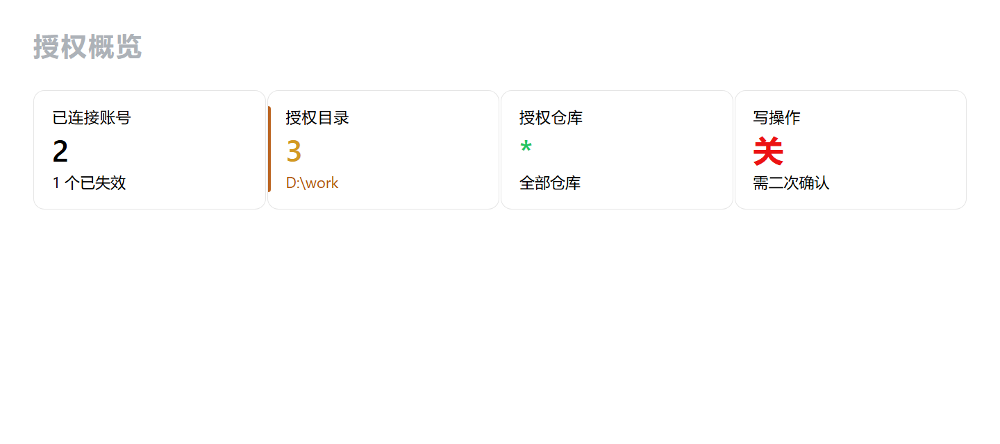
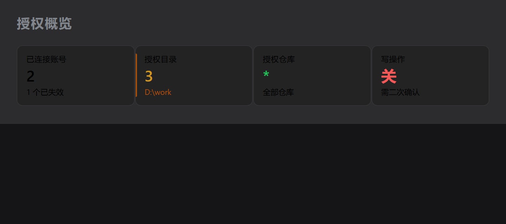
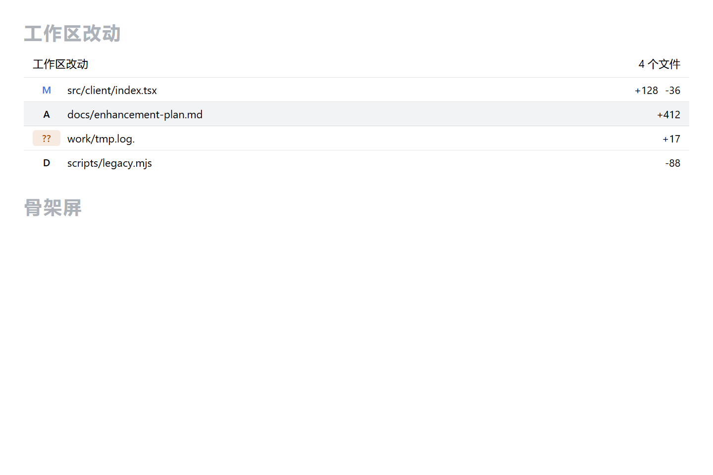
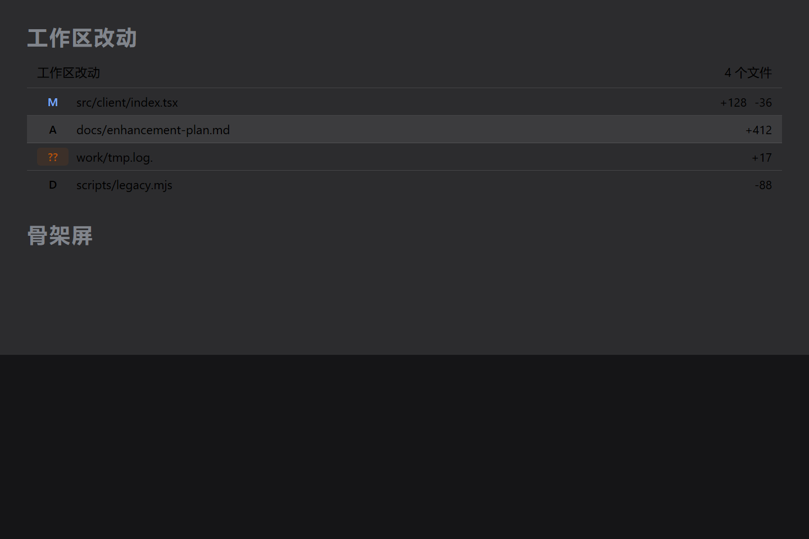
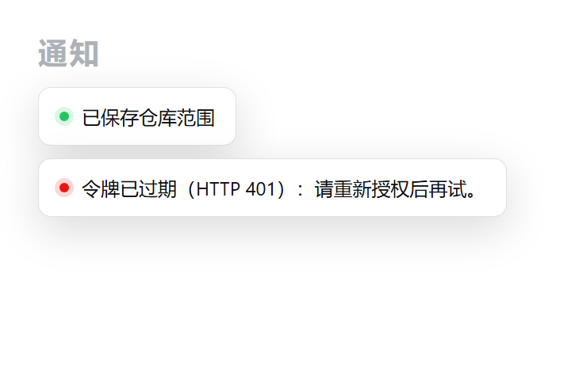
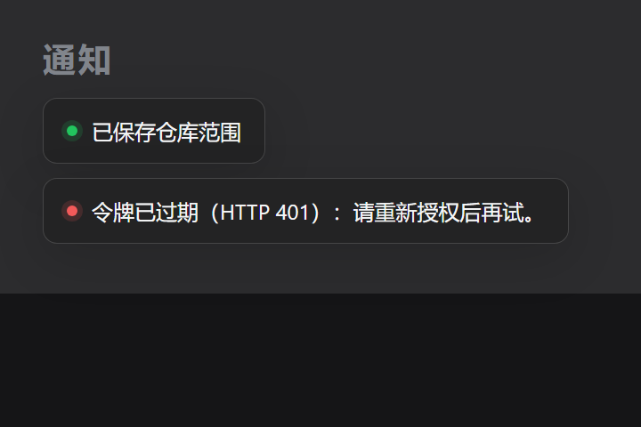
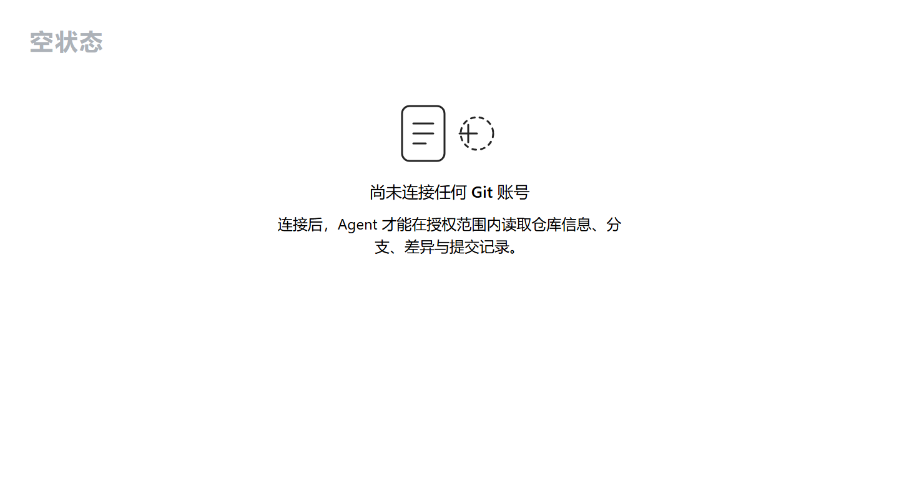
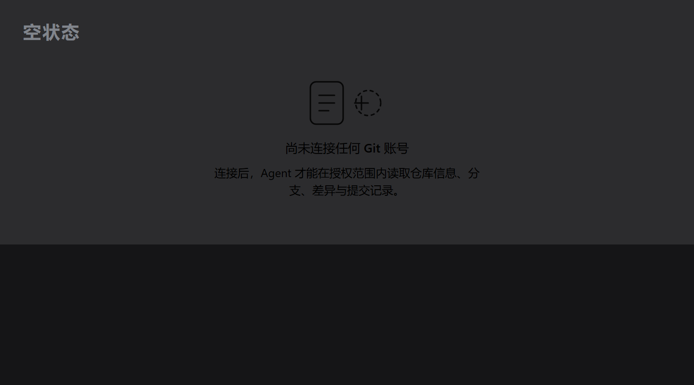

# @zjj/dsh-git-panel

DSH（DeepSeek Harness）桌面端插件：**Git 账号接入 + 受控仓库操作**。

配置全部放在 **DSH 设置页**（左侧导航新增 `Git` 分节）；输入框下方左侧只保留一个 **opencode 风格的分支状态 chip**（如 `⎇ main ↑2 3*`），点它弹出分组菜单（仓库 / 打开 / 设置），工作台、当前分支详情、初始化向导与设置页都从这里进。同时把 Git 查询与受控写操作封装成 Agent 可直接调用的工具。

---

## 一、能力总览

| 模块 | 说明 |
| --- | --- |
| 配置位置 | **DSH 设置页** → 左侧导航 `Git` 分节（`settings.section` slot，`order: 20`） |
| 输入区显示 | **opencode 风格分支 chip**：`⎇ <分支名>` + `↑N`/`↓N`/`N*`（ahead/behind/改动数）；游离 HEAD 显示短 SHA；**非 Git 仓库时保留一个灰化的 `Git` 入口**（悬停提示「当前会话目录不是 Git 仓库」），只有取不到会话目录时才整块不渲染 |
| 点击 chip | **先检测再决定**：弹出插件自绘菜单（不依赖宿主快捷键），菜单随检测结论变化 —— **未初始化**时只给「初始化 Git 项目」（进入初始化页）；**已初始化**时按**分组**给出：`仓库` 组 = Git 工作台（主操作）/ 刷新状态 / 当前分支详情，`打开` 组 = 打开项目目录，末尾独立一行 Git 设置；检测失败时显示失败原因 + 「重新检测」，不给初始化按钮，也不给分支详情 |
| 状态刷新 | **不轮询**：只在四个时机重新检测 —— cwd 变化、窗口获焦（`window focus`）、页面重新可见（`visibilitychange`）、打开菜单；工作台/初始化页关闭后各刷一次 |
| 分支拓扑 | 车道式提交图**直接贴在历史列表左侧**（不再单独占一个视图）：每条活跃分支固定车道、8 色循环按车道取色、节点/同车道竖线/跨车道 S 形贝塞尔三种图元，分叉与汇合位置准确；整列只渲染一个 SVG，按 hash 与历史行对齐；行数默认 60（20–200 可调，超上限时标注「仅显示最近 N 条」） |
| 状态跟随项目 | chip 的 cwd 通过 `useSyncExternalStore` 订阅会话列表快照；**切换/加载项目会先清空上一次结果再重新检测**，菜单每次打开也会重新检测一次 |
| 账号接入 | OAuth 设备码 / 个人访问令牌（PAT）两种方式，支持 GitHub、GitLab、Gitea |
| 账号 → 远程仓库 | **每个账号一张卡片，卡片里直接内联该账号在平台侧的**全部远程仓库**（`GET /account/repos`，打开设置即自动拉取，不用先点展开）；每行右侧是三档分段控件（完整 / 只读 / 无权限），点一下即提交，无需保存按钮；新账号默认完整权限 |
| 远端归属闸门 | 远端写端点（fetch/pull/push/remotes-add）按目标 remote 的 `owner/repo` 校验账号权限，非 `full` 直接 403 |
| 授权状态 | 已连接账号列表、平台、接入方式、scopes、`connected` / `expired` / `error` 状态徽章、最近一次校验时间与错误 |
| 断开 / 重新授权 | 每个账号可单独「校验」与「断开」；同平台同登录名再次连接视为重新授权并覆盖旧记录 |
| 仓库范围 | `allowedRepos`（`owner/repo` 白名单，`*` 表示全部）、`allowedRoots`（本机绝对路径白名单，`*` 表示不限制目录） |
| API 地址 | 每个账号记录 `apiBase`（REST API 根地址，如 `https://api.github.com`），与网页域名 `host` 分开存：GitHub 的 API 不在 `github.com` 上，混用会拿到 410 |
| 写操作闸门 | `allowWrite` 默认关闭；开启后仍默认 `requireConfirm`，需二次确认才真正执行 |
| Agent 工具 | 8 个 `git_*` 工具，见第五节 |
| 凭据安全 | AES-256-GCM 落盘，界面与接口一律不回显明文令牌，日志走脱敏规则 |
| 授权概览 | 设置页顶部一条**概览带**（不再是四格统计卡）：账号数（已连接/异常）、授权目录数（`*` 显示 `∞`）、授权仓库数（**全局白名单 + 各账号权限表里显式列出的仓库数**）、写操作开关（开启时用 warn 色强调），右侧是「界面」「高级设置」「授权说明」三个折叠开关（都是默认收起的一行按钮） |
| 默认账号 | 多账号时可指定默认账号（Agent 侧优先使用），账号行显示「默认账号」徽章或「设为默认」按钮 |
| 账号卡（密度版） | 每个账号**默认压成一行摘要**：状态点 + 备注名 + `平台 · 接入方式` + 连接状态 + 默认徽章 + 主机 + 「可访问 n / m 仓库」，点一下才展开仓库权限列表。**至多自动展开一张卡**（默认账号优先），整节首屏高度实测 503px（视口 960px），不再需要滚两三屏 |
| 账号操作 | 展开与收起之外，账号的所有操作（编辑账号 / 校验 / 刷新仓库列表 / 设为默认 / 断开）统一收进摘要行右侧**一个 `⋯` 菜单**：编辑账号点开**连接弹窗**并预填平台/接入方式/host/apiBase（令牌留空），「断开」在菜单里标红；危险操作不再与日常操作混排在同一排 |
| 权限范围（scope） | PAT 账号的 scope 列表**默认不常驻**，收起时只显示「权限范围 n 项」一个按钮；展开后用 `overflow-wrap:anywhere` 换行，长标识符不撑出横向滚动 |
| 连接账号 | 「连接账号」是一个 **Modal 弹窗**（不再常驻在页面里）：平台 / 备注名 / 接入方式（PAT 或 OAuth 设备码）/ 令牌或 clientId / 主机与 API 地址，成功即关闭并刷新账号卡 |
| 仓库筛选 | 展开后的仓库列表带工具行：**搜索框**（按 `owner/repo` 过滤）+ **权限筛选分段**（全部 / 完整 / 只读 / 无权限）+ 计数「共 n / m 个仓库」+ 刷新按钮；列表被分页截断时底部提示。分段控件与筛选 chip 的**点击热区实测 ≥24 CSS px**（WCAG 2.5.8） |
| 空态与就地建仓 | 0 仓库账号的空态改成**一行紧凑提示**（不再是 88×60 插画 + 两行说明），并就地给出「新建仓库」：仓库名 + 私有勾选 + 「创建并选用」，建完自动授权 `full` 并刷新该账号列表（`POST /repo/create` 不传目录，走账号维度） |
| 当前分支详情 | **不单独占一个按钮** —— Git 只保留输入框下方那一个 chip 入口；点 chip 打开菜单，选「当前分支详情」即在**页面中央**弹出 Modal，用**时间线**逐条展示该分支的提交记录（左侧竖线 + 节点，首条节点带光晕；每行 = 提交信息 / 短哈希 / 作者 / 时间），可滚动、不溢出视口；菜单项副标题与弹窗标题都带当前分支名；×、遮罩点击、Esc、底部按钮四种方式均可关闭 |
| 初始化 | 未初始化目录点「初始化 Git 项目」进入**单页表单 + 右侧实时计划**（不再分步）：左侧一次填完 ①选账号 ②选远程仓库（平台列举 / **在该账号下新建仓库** / 新地址 / 手工 `owner/repo`）③分支名与首次提交信息，右侧同步显示将要执行的动作清单与就绪状态；提交后右侧切换为执行结果（成功给步骤清单，失败给中文原因并可就地改）。「新建仓库」是就地展开的一行：仓库名（默认取当前目录名）+ 私有勾选 + 「创建并选用」，建完自动授权 `full` 并回填为本次远程 |
| 工作区改动明细 | 在 **Git 工作台「改动」视图**（顶部页签第一项）左栏列出未提交文件：状态字母 + 路径 + 增删行数 + 已暂存标记；提交框固定在列表上方（暂存区 → 写提交信息 → 提交），选中文件后出现批量条；加载中用骨架屏，空状态用图形化插画 |
| 轻提示 toast | 所有动作反馈统一为右下角 toast（成功/失败/信息三态），2.6 秒自动消失；菜单关闭后提示仍保留 |
| 工作台导航 | **顶部页签条** 5 项：**改动 / 历史 / 文件 / 标签 / 贮藏**（选中态为下划线，带数量徽标），下方单视图切换（视图内容懒加载，切到才拉数据）；窄屏 ≤760px 时页签可横向滚动 |
| 改动页双栏 | 左栏提交框 + 三组改动列表，右栏**就地差异**（点文件行即渲染，不再弹模态框）；右栏标题行带「放大」按钮，可把差异放大成 1040px 模态框 |
| 多仓库切换 | 顶栏仓库名是一个下拉（`GET /repo/discover` 扫授权目录下的仓库，下探 3 层、上限 50 个）；切换后改动/历史/文件/标签/贮藏全部作用于所选仓库，并清空上一仓库的选中项与提交信息。**扫描范围严格受 `allowedRoots` 限制** |
| 差异视图 | 独立模块 `diffview.tsx`：**行号**（左右两侧旧/新行号）、**Ctrl/⌘+F 就地查找**（F3 / Shift+F3 跳转、Esc 清空、命中行高亮并滚到视口中央、`n/m` 计数）、**四种布局**统一 / 对照 / 变更前 / 变更后（选择写入 localStorage，下次打开沿用）、**词级高亮**（按 token 求公共前后缀，只标真正变化的中段）、**未变更块折叠**（连续 6 行以上折叠，保留首尾各 3 行，点开就地展开）、**语法高亮**（Prism，15 种语言，纯字符串 API 不扫宿主 DOM） |
| 历史搜索与分页 | 提交历史支持关键词搜索（走 git 原生 `--grep --fixed-strings --regexp-ignore-case`，不是前端过滤，所以「加载更多」能翻到真正的旧提交）+ 每页 80 条「加载更多」，到底显示「没有更多了」 |
| 历史泳道 | 历史列表左侧可贴**提交拓扑泳道**（与「列表」两档切换，偏好持久化）：整列只渲染一个 SVG，按 hash 把 `/repo/graph` 的行号对齐到历史行；缺图数据的提交补纯节点占位，搜索过滤后仍按提交对齐 |
| 文件浏览 | 工作台「文件」视图：懒加载目录树 + 文件预览，走 `GET /repo/tree` 与 `GET /repo/file`；忽略项（`node_modules` / `.git` / `dist` / `lib`）半透明；二进制文件与超大文件（>512 KiB）明确提示不预览；Markdown 可切「渲染 / 源码」两态（自带安全渲染器，先转义再替换，不支持内嵌 HTML）、图片走 `GET /repo/image`（上限 4 MiB，点图切原尺寸/适宽）、HTML 永远只显示源码；窄屏下改为「树 / 预览」钻取式切换 |
| 标签管理 | 工作台「标签」视图：列标签（附注标签带徽章）+ 新建（可填附注信息，不填为轻量标签）+ 删除（二次确认）+ 推送单个标签到远端（走远端归属闸门） |
| 贮藏 | 工作台「贮藏」视图：保存（可写说明、可含未跟踪文件）、`pop` / `apply` / `drop`；冲突时给中文提示并说明要手动删 `stash@{n}` |
| AI 生成提交信息 | 提交框上的「AI 生成」按钮：取暂存区 diff（无暂存则取工作区）+ 最近 8 条提交当风格样本，调宿主 `ctx.llm` 生成一行中文提交信息并回填输入框。**模型服务或默认模型取不到时明确提示，不猜 provider**；不落盘、不改仓库 |
| 窄屏适配 | 两道宽度断点：`@media (max-width:760px)` 收窄（工作台改单栏、导航转横排、差异并排降为单列、文件浏览钻取、弹窗贴边、初始化页单列）；`@media (max-width:620px)` 改为「一次只干一件事」（隐藏泳道列与提交元信息、搜索框独占一行、差异只留单侧、弹窗几乎满屏） |
| chip 二态 | chip 颜色区分干净/脏：有未提交改动时用 warn 色（`data-dirty="1"`），干净时用常规色 |
| 改动汇总条 | 「改动」视图顶部一行汇总：文件数 · 新增行数（绿）· 删除行数（红）· 已暂存数，由 `changes.files` 累加得出，随刷新更新 |
| 提交回退与撤销 | 提交详情弹窗底部四个动作：**回退并保留暂存**（`reset --soft`）/ **回退并保留改动**（`--mixed`）/ **回退并丢弃改动**（`--hard`，需二次确认）/ **撤销此提交**（`revert --no-edit`，冲突时提示手动 `git revert --continue`）；全部走 `POST /repo/reset` 与 `POST /repo/revert`，受 `allowWrite` 闸门约束 |
| 发布分支 | 当前分支还没有上游时，Push 按钮自动变「发布分支」，一次 `git push -u` 建跟踪；按钮带 `data-publish="1"` 与副标题说明 |
| 界面偏好 | 设置页「界面」分节（概览带右侧开关）：差异默认布局四档 / 语法高亮开关 / chip 显示开关 / 历史泳道开关 / 泳道一次拉多少条 20~200 / **AI 模型固定**（下拉来自 `GET /llm/models`，选「跟随会话默认」则随会话切换）/ 一键回默认。全部写 localStorage 并即时生效（跨标签页同步） |
| 8 语言 | 简中 / 英 / 日 / 西 / 法 / 德 / 俄 / 葡，各 360 键与中文键集合完全一致；新增 6 语通过宿主 `locale.addLanguage({ id, label, fallback: "en" })` 注册，缺键自动回落英文不会显示裸键名 |
| 版本提示 | client 侧查 GitHub 最新 release（`/releases/latest`，5 秒超时、进程内缓存、失败静默），只在打开 chip 菜单时查一次；有新版本时菜单顶部给一行「有新版本 vX.Y.Z」并链到 release 页；**预发布（`-rc`）不提示** |

---

## 二、安装

从 Git 源安装（仓库已入库 `lib/` 构建产物，装完即可用）：

```bash
dsh plugin --profile desktop add github:zjj1769404838/dsh-git-panel
```

从本地目录安装（改代码时用）：

```bash
npm install --include=dev
node scripts/build.mjs
dsh plugin --profile desktop add link:/absolute/path/to/dsh-git-panel
```

装完重启桌面端（node 半边与 client 模块表在启动时扫描 `dsh.client` 行）；client 半边改动后需在 GUI 里 **Ctrl+Shift+R 硬刷新**。

卸载：

```bash
dsh plugin --profile desktop remove @zjj/dsh-git-panel
```

---

## 三、账号授权配置方式

### 方式一：OAuth 设备码（推荐本机交互式使用）

打开 **设置页 → Git → 账号**，选平台 → 接入方式选「OAuth」→ 填该平台的 OAuth App **Client ID** → 「连接」。

- GitHub：`POST https://github.com/login/device/code` → 浏览器打开授权页、输入 8 位代码 → 插件自动轮询换取令牌。
- GitLab：`POST https://gitlab.com/oauth/authorize_device`（自建实例需先在实例上开启 device flow）。
- Gitea：需自填实例地址与 API Base，并确认实例支持 device flow。

安全细节：设备码只存在服务端内存，页面拿到的是一次性 `pollKey`；`pollKey` 20 分钟过期，授权成功后立即失效。

> 适合：本机、有人在场点一次浏览器。不适合：CI / 无人值守。

### 方式二：个人访问令牌 PAT（推荐 CI 与无人值守）

点 **设置页 → Git → 账号**，接入方式选「PAT」→ 粘贴令牌 → 「连接」。

- GitHub：Fine-grained token，可精确限制到单个仓库与只读权限（`Settings → Developer settings → Personal access tokens`）。
- GitLab：`User Settings → Access Tokens`，建议只勾 `read_api` + `read_repository`。
- Gitea：`Settings → Applications → Generate New Token`。

> 适合：CI、脚本、无法打开浏览器、需要最小权限的场景。令牌可随时在平台侧撤销。

### 仓库范围（必须配置，否则 Agent 拒绝一切操作）

**设置页 → Git → 仓库范围**：

- **允许的远程仓库**：每行一个 `owner/repo`；`*` 表示不限。
- **允许的本机目录**：每行一个绝对路径，如 `D:\my-projects\app`。
- **允许写操作**：默认关闭。
- **写操作需要二次确认**：默认开启。

范围为空 = 全部拒绝（fail-closed）。路径比较按路径段进行，`D:\repo-evil` 不会命中 `D:\repo` 的授权。

**账号级仓库权限（`repoPermissions`）**：设置页展开账号卡即列出该账号在平台侧可见的**全部远程仓库**（打开设置就自动拉取，摘要行先给出数量），每行右侧三档分段控件，点一下即提交单条（`POST /repo/permission`）：

| 档位 | 含义 |
| --- | --- |
| `full` | 可读可写（可 fetch/pull/push） |
| `read` | 只读 |
| `none` | 未授权（远端写操作直接 403） |

- **新账号默认完整权限**（新账号建立一张空权限表，表内未列出的仓库按 `full` 处理）；要收紧就在列表里逐个改成 `read` / `none`。
- 权限表按 `accountId → owner/repo` 组织，与账号绑定；账号被移除时它那张表一并清除。
- **仓库键保留全部路径段**：GitLab 的子组仓库是 `group/subgroup/repo`，键就存三段。只取前两段会把同一子组下的多个仓库折叠成 `group/subgroup`，一个仓库的权限会串到另一个仓库上。
- 列表分页拉取（每页 100，最多 5 页 = 500 个仓库）；到上限或后续页失败时返回 `truncated:true`，界面上会提示「仓库较多，仅显示前 N 个」。
- 老账号（升级前就连好的、还没有权限表）沿用全局 `allowedRepos` 判定，两条路径都拒绝才算未授权。
- 远端写端点（`/repo/fetch`、`/repo/pull`、`/repo/push`、`/repo/remotes/add`）会解析目标 remote 的 `owner/repo`，**解析得出且该账号不是 `full` 时直接 403**；目标地址解析不出（如 `file://` 本地路径）时跳过归属校验并记一条 warn。

---

## 四、数据存放

| 内容 | 路径 |
| --- | --- |
| 状态（账号元数据、范围设置） | `$DSH_HOME/git-panel/state.json`（默认 `~/.dsh/git-panel/state.json`） |
| 加密密钥 | `$DSH_HOME/git-panel/key.bin`（0600） |
| 令牌密文 | 存在 `state.json` 的 `secret` 字段，格式 `v1.<base64(iv|tag|ciphertext)>` |

`state.json` 写入走「临时文件 + rename」，权限 0600；文件损坏时自动改名为 `.broken` 并重建，不会因坏文件导致插件启动失败。

界面与 `/state`、工具返回值中的 `secret` 一律置空；日志经 `redact()` 处理，覆盖 `ghp_*` / `github_pat_*` / `glpat-*` / `Authorization: Bearer|Basic|token` / URL 内嵌密码 / `access_token=` 等查询参数。

---

## 五、Agent 可用工具

| 工具 | 作用 | 是否改状态 |
| --- | --- | --- |
| `git_panel_status` | 账号（脱敏）、授权范围、写开关现状 | 否 |
| `git_repo_info` | 当前分支、远端（脱敏）、改动文件数、文件数、最近提交 | 否 |
| `git_branches` | 分支列表（含上游、ahead/behind、是否当前） | 否 |
| `git_diff` | 差异：`worktree` / `staged` / `commit` / `range` | 否 |
| `git_log` | 提交记录，支持 author / grep / since / path 过滤 | 否 |
| `git_remote_info` | 远程仓库元信息（默认分支、可见性、stars、最近推送） | 否 |
| `git_write` | 受控写操作：`add` / `commit` / `checkout` / `switch` / `restore` / `stash` / `tag` | **是** |
| `git_confirm` | 确认或取消上一步 `git_write` 的待执行操作 | **是** |

统一约束：

1. **先授权后操作**：所有涉及目录的工具先查 `allowedRoots`（`*` 视为不限制），再校验目标是否真是 git 仓库；未授权路径连「是不是仓库」都不告知。
2. **改状态前必须说明**：`git_write` 在 `requireConfirm` 开启时只返回 `{pending:true, summary, reason}` 与 18 位 `confirmToken`（5 分钟有效），`summary` 明确写出「将要执行的命令 + 目标仓库绝对路径」；未确认前仓库状态不变。
3. **失败保留 Git 输出**：错误信息包含原始 stderr 关键行，并对常见失败给出人话解释（not a git repository / no commits yet / pathspec did not match / Authentication failed / would be overwritten）。
4. **不走 shell**：`execFile('git', args)`，并拒绝 `--upload-pack=`、`--exec=`、`--receive-pack=`、`--template=`、`--separate-git-dir=`、`--open-files-in-pager=`、`--pager=` 等可注入参数的选项；env 设 `GIT_TERMINAL_PROMPT=0`、`GIT_ASKPASS=''`、`GIT_PAGER=cat`、`GIT_EDITOR=true`。

---

## 六、本地 HTTP 接口（设置面板使用）

前缀 `/dsh-git-panel`：

| 方法 | 路径 | 说明 |
| --- | --- | --- |
| GET | `/health` | 健康检查（status / plugin / version / uptime / accounts） |
| GET | `/state` | 账号（脱敏）+ 设置 + 平台元数据 |
| GET | `/providers` | 平台元数据 |
| GET | `/account/repos?accountId=<id>` | 列出该账号在平台侧可见的全部远程仓库（`{fullName, name, owner, url, private, defaultBranch}`）：GitHub `GET /user/repos`、GitLab `GET /api/v4/projects?membership=true`、Gitea `GET /api/v1/user/repos`；单次最多 100 条、不分页。账号不存在 / 无凭据 / 平台拒绝时返回 `{ok:false,error:'中文原因',repos:[]}`，**不回显令牌** |
| GET | `/repo/status?cwd=<绝对路径>` | 供输入区分支 chip 使用：`{isRepo, root, branch, detached, head, ahead, behind, changed, authorized, reason}`；`reason` 三态区分结论 —— `repo`（确认是仓库）/ `no-repo`（目录存在但没有 `.git`，**只有这种才允许显示初始化**）/ `invalid`（路径非法、不存在、不可读 —— 属于检测失败，不能当成未初始化）；非仓库不是错误（`isRepo:false`），未授权目录返回 `authorized:false` 且不泄露 ahead/behind |
| GET | `/repo/graph?cwd=<绝对路径>&limit=<5-100>` | 供 chip 菜单的分支拓扑图使用：`{isRepo, root, branch, head, detached, reason, truncated, laneCount, rows}`；每行 `rows[i]` 含 `{hash, short, parents, author, date, subject, refs, row, lane, segments, through}` —— `lane` 是本行所在车道、`segments` 是向下连到父提交的线（`from === to` 为同车道直落，否则为跨车道转折）、`through` 是穿过本行的其他车道；未授权目录返回 `authorized:false` 且 `rows` 为空、`laneCount:0`（不泄露提交历史） |
| GET | `/repo/changes?cwd=<绝对路径>` | 供 chip 菜单的「工作区改动明细」使用：`{isRepo, root, branch, dirty, files}`；每个 `files[i]` 含 `{path, index, worktree, added, deleted, staged}` —— `index`/`worktree` 是 git porcelain 两列状态码（`M` 修改 / `A` 新增 / `D` 删除 / `R` 重命名 / `C` 复制 / `??` 未跟踪），`added`/`deleted` 是增删行数（未跟踪二进制无法计数时置 0，界面显示「—」）。未授权目录只回 `{isRepo:true, root:'', branch:'', dirty:false, files:[]}` 空壳（**不泄露路径、分支与文件名**）；非仓库回 `{isRepo:false,…}` |
| GET | `/repo/commits?cwd=<绝对路径>&limit=<1-200>&offset=<n>&ref=<分支或提交>&search=<关键词>` | 提交历史：`{ok, root, commits, truncated}`；`search` 走 git 原生 `--grep`（`--fixed-strings` + `--regexp-ignore-case`，关键词上限 200 字符），**在后端过滤**，因此分页能翻到真正的旧提交 |
| GET | `/repo/tags?cwd=<绝对路径>` | 标签列表：`{ok, root, tags}`，每项 `{name, hash, subject, date, annotated}`；按创建时间倒序、上限 500 |
| GET | `/repo/stash?cwd=<绝对路径>` | 贮藏列表：`{ok, root, stashes}`，每项 `{index, ref, branch, subject}`；无贮藏时返回空数组而非报错 |
| GET | `/repo/tree?cwd=<绝对路径>&path=<相对路径>` | 目录列表：`{ok, root, path, entries, truncated}`，每项 `{name, path, kind:'file'|'dir', size, lang}`；目录在前、同类按名称排序、单次上限 2000 项。路径经 `realpath` 解析后判越界（软链外指被拦），`..` / 绝对路径 / 盘符 / `.git` 段一律拒绝 |
| GET | `/repo/file?cwd=<绝对路径>&path=<相对路径>` | 文件内容：`{ok, root, path, content, size, truncated, binary, lang}`；>512 KiB 截断（`truncated:true`）、NUL 嗅探判二进制（`binary:true` 时不回内容） |
| POST | `/repo/tags/create` | 新建标签：`{cwd, name, ref?, message?}`；有 `message` 建附注标签，否则轻量标签；重名回「标签已存在」 |
| POST | `/repo/tags/delete` | 删除本地标签：`{cwd, name}` |
| POST | `/repo/tags/push` | 推送单个标签：`{cwd, name, remote?}`；**先过远端归属闸门**（目标 remote 的 `owner/repo` 对该账号必须 `full`） |
| POST | `/repo/stash/save` | 保存贮藏：`{cwd, message?, includeUntracked?}`；无改动回「当前没有可贮藏的改动」 |
| POST | `/repo/stash/action` | 贮藏动作：`{cwd, action:'pop'|'apply'|'drop', index}`；action 白名单校验，非法回 400「不支持的贮藏操作」；冲突时提示手动删 `stash@{n}` |
| POST | `/repo/suggest-message` | **AI 生成提交信息**：`{cwd, hint?}` → `{ok, message, source:'model'|'none', provider, model, error}`；取暂存区 diff（无则工作区）+ 最近 8 条提交当风格样本，调宿主 `ctx.llm.prepareCall` + `stream`，45 秒超时。**只读仓库、不落盘**，因此走 `requireRead` 而不是 `requireWrite` |
| POST | `/repo/init` | 在会话目录执行 `git init -b main`（幂等：已有 `.git` 返回 `created:false`，绝不覆盖，**且不删除/不改动目录里已有文件**）；必须先过同源校验 + `allowedRoots` 授权闸门，未授权目录 403 且不创建任何文件；写开关关闭时同样 403 |
| POST | `/repo/bootstrap` | **一键初始化（单页初始化页的执行端）**：请求体 `{cwd, accountId, remoteMode:'existing'|'new', repoFullName?, remoteUrl?, branchName, branchMode:'new'|'existing', initialCommitMessage?}`；依次完成 ①账号与凭据校验 → ②解析远程目标（选已有仓库时按 `repoFullName` 在平台列表里匹配出 URL）→ ③远端归属授权（`repoKey` 必须对该账号 `full`，否则 403「未授权写入」）→ ④`git init`（已有仓库则复用）→ ⑤添加远程 `origin`（**已存在且指向不同地址时直接报错，不静默覆盖**）→ ⑥分支（`new` 撞名时降级为切换并在 `steps` 里说明）→ ⑦可选首次提交；成功回 `{ok:true,root,branch,remoteName:'origin',remoteUrl,steps:[中文步骤]}`，失败回 `{ok:false,error:'中文原因'}`（HTTP 200）。**只做本地操作，不 push** |
| POST | `/pat/connect` | PAT 接入 |
| POST | `/repo/create` | **在指定账号下新建远程仓库**：请求体 `{accountId?, name, private?, description?, cwd?}`；`accountId` 缺省取默认账号；给了 `cwd` 就先过 `requireWrite`（目录授权 + 写开关），只建远端时可不传。按平台分别调 GitHub `POST /user/repos`（或 `/orgs/{org}/repos`）、GitLab `POST /api/v4/projects`、Gitea `POST /api/v1/user/repos`；仓库名按 `^[\w.-]{1,100}$` 校验（不合法 400「仓库名不合法」）、缺名 400。**建完自动把该仓库对该账号的权限写成 `full`**，否则紧接着的 push 会被「未授权写入」拦下。成功回 `{ok:true, repo, state}`，失败回 `{ok:false, error:'中文原因'}`（HTTP 200；401 提示重新授权、403 按平台提示所需 scope、422/400 提示仓库已存在或名称不合法） |
| POST | `/oauth/start` | 发起设备码流程，返回 `pollKey` 与 `userCode` |
| POST | `/oauth/poll` | 用 `pollKey` 轮询（不传设备码） |
| POST | `/accounts/remove` | 断开账号 |
| POST | `/accounts/recheck` | 重新校验令牌 |
| POST | `/repo/permission` | **单条仓库权限写入**：请求体 `{accountId, repo, permission:'full'|'read'|'none'}`，只改「该账号对该仓库」这一格；缺参 400、档位非法 400、账号不存在 404；成功回 `{ok, repo, permission, state}`。取代「整表 POST /settings」的做法——整表覆盖在连点/多窗口下会互相抹掉对方的改动 |
| POST | `/settings` | 保存仓库范围与写开关；也接收 `repoPermissions`（账号 → 仓库 → 权限档位，见下表；保留给批量导入，界面不再走这条路） |

加固项：请求体上限 256 KiB（超限 413 并断开）；同源校验（跨站 403）；`cache-control: no-store` + `x-content-type-options: nosniff`；未知接口 405/404。

---

## 七、开发与验证

```bash
npm run bundle        # 构建 lib/index.js + lib/client.js
npm run typecheck     # tsc --noEmit
npm run gates         # 303 项插件契约门禁
npm run test:hardening# 197 项加固回归（含真实 git 仓库端到端 + 仓库权限档位 + 单条权限写入 + 新建远程仓库）
npm run test:e2e      # 32 项设置页 GUI 端到端验证（需要本机 Edge + DSH Web 在跑）
npm run test:e2e:wb   # 31 项 Git 工作台 GUI 端到端验证（含居中模态框形态、点弹窗不消失、改动页双栏就地差异）
npm run test:e2e:newui # 19 项新入口体系 GUI 端到端验证（单一 chip 入口 + 分组菜单）
npm run test:e2e:v20  # 18 项 v20 新能力 GUI 端到端验证（界面分节 / 汇总条 / Markdown 表格 / 回退撤销）
npm run preview       # 用真实 CSS + 宿主 token 渲染 docs/preview/*.png（需要本机 Edge）
npm test              # gates + hardening
```

`test:e2e` 用 `playwright-core` 驱动**本机 Edge**（headless）打开真实 DSH Web GUI，验证「打开 Git 设置」这条链路：认证通过 → chip 存在 → 菜单里有「打开 Git 设置」→ 点击后**设置面板打开**且**智能体团队面板没被误开** → 导航落在 Git 分节 → Git 分节内容渲染 → **新结构逐项在位、旧结构逐项消失**（`.dgp-overview` 在、`.dgp-stats` 与 `.dgp-tabs` 为 0、`.dgp-repo-toggle` 为 0、`select.dgp-perm-select` 为 0、账号卡 `.dgp-acct` 在、权限分段 `.dgp-perm-seg` 在、仓库工具行 `.dgp-repos-toolbar` 在、「连接账号」「高级设置」入口在）→ 进已有会话后「智能体团队」入口自身仍能打开。此外还验**密度**：账号卡压成一行摘要（`.dgp-acct-head` 为 0）、至多自动展开一张、scope 收起时 `.dgp-scopes` 为 0、0 仓库空态无非 dense 插画、`⋯` 菜单默认不渲染、分段控件热区 ≥24px、**整节高度小于两屏视口**。脚本会**先按 `projectRow` 边界切到本项目的会话**再读 chip（GUI 默认可能停在非 Git 目录的会话，那时 chip 只是灰化占位）。脚本自己按宿主 `dsh-client-connection` 的规则从 `~/.dsh/.credentials.yaml` 铸造 `dsh-auth-*` cookie（**不打印任何凭据**），URL 可用 `--url` 或 `DSH_WEB_URL` 覆盖。

`test:e2e:wb` 是工作台的点击回归：切到本项目的会话 → chip 显示真实分支 → 打开工作台（断言挂在 `body` 直属层，脱离 composer 的 `container-type:inline-size` 包含块）→ 点分支管理开二级弹窗 → **把弹窗内的标题/正文/输入框/复选框逐个点一遍，每次点完断言「弹窗 + 工作台 + chip」三件套都还在** → Pull / 远程仓库 / 提交详情同样处理 → 切换顶部页签（改动/历史/文件/标签/贮藏）、刷新、勾选改动行都不许关掉工作台；并断言改动页是双栏、点文件行在右栏就地渲染差异而不弹模态框。这条链路正是「点一下弹窗就整片消失」的复现路径。

`test:e2e:newui` 验证重构后的入口体系：切到本项目会话 → **Git 只有 chip 一个入口**（chip 旁不再有独立的分支详情按钮）→ 菜单里五个入口齐全（刷新状态 / Git 工作台 / 打开项目目录 / 打开 Git 设置 / 当前分支详情）→ 菜单里的「当前分支详情」副标题带当前分支名，点它后在**页面中央**弹出 Modal（标题带分支名、挂在 `body` 直属层、视口内不溢出）→ 正文逐条展示提交四要素（提交信息 / 短哈希 / 作者 / 时间）→ 关闭后 chip 仍在且无页面 JS 错误。**node 半边不热重载**，桌面端未重启时端点不可用，提交行断言按 `SKIP` 处理（端点级行为由 `test:hardening` 兜底）。

`test:e2e:v20` 验证 v20 的新能力：切到本项目会话 → 设置页 Git 分节 → 展开「界面」面板（差异布局四档 / 行为开关三项 / AI 模型下拉有选项 / 泳道行数输入框）→ 打开工作台看改动汇总条 → 进文件视图打开 `README.md` 断言 Markdown **渲染视图**出现且**渲染出标题元素与表格** → 进历史点首行开提交详情，断言回退/撤销按钮、差异四档、行号列。截图落在 `.work/v20-*.png`（不进仓库）。

`test:hardening` 用 mock ctx 驱动**构建产物 `lib/index.js`**，在临时 `DSH_HOME` 下跑，覆盖：路由注册、工具注册、跨站/超大请求拦截、设置归一化、密文不外泄、OAuth 缺 clientId 提示、未授权仓库/目录拒绝、写操作默认拒绝、`/repo/status` 的六种形态（缺 cwd / 非仓库且 `reason=no-repo` / 目录不存在与相对路径 `reason=invalid` / 已授权真实仓库 `reason=repo` / 未授权不泄露 ahead-behind）、`/repo/init` 的十种形态（未授权拒绝且不落 `.git` / 已授权创建 / 回报分支 / 幂等 / 缺 cwd / 目录不存在 / **初始化后原有文件与子目录内容原样保留**）、`/repo/changes` 的七种形态（缺 cwd 400 / 非仓库 `isRepo:false` / **未授权目录只回空壳不泄露路径与分支** / 已授权仓库回报 root+branch+dirty / 工作区修改为 `M` / 已暂存文件标记 `staged` / 未跟踪文件为 `??` / 文件按路径升序）、真实仓库的 status/branches/diff/log 与「确认前不执行、取消不执行、确认后执行、令牌不可复用」。

---

## 八、目录结构

```
src/
  index.ts            node 半边入口（注册路由 + 工具）
  types.ts            本地 ctx 类型（避免静态依赖 @deepseek-ai/*）
  node/
    paths.ts          DSH_HOME / 状态文件 / 密钥文件路径
    vault.ts          AES-256-GCM 加解密 + 脱敏规则
    store.ts          状态读写、范围判定
    providers.ts      GitHub / GitLab / Gitea 的 API 与 OAuth 设备码流程
    git.ts            git 命令执行与失败解释
    tools.ts          8 个 Agent 工具
    handler.ts        HTTP 路由
  client/
    index.tsx         注册与输入区：BranchChip（conversation.input.left）+ 字典/类型入口
    settings.tsx      设置页 Git 分节（settings.section）：概览带 + 账号卡（默认一行摘要，展开才列仓库权限）+ ⋯ 菜单 + 就地建仓 + 连接弹窗 + 界面/高级设置/授权说明三个折叠面板
    shared.tsx        api/routeUrl/类型 + 全套 .dgp-* 样式 + Toast/EmptyState/Skeleton/图标
    onboard.tsx       初始化页（单页表单 + 右侧实时计划）与当前分支详情（时间线弹窗）
    graphview.tsx     分支拓扑泳道列（导出 LaneColumn/laneWidth，历史视图使用）
    markdown.ts       极简 Markdown 渲染器（先转义再替换，无内嵌 HTML）
    locales/          日/西/法/德/俄/葡 六份语言字典 + 语言目录（各 360 键）
    workbench.tsx     居中模态框式 Git 工作台（顶部页签条：改动/历史/文件/标签/贮藏；改动页左列表右就地差异）+ 分支/新建分支/提交详情/远程/Pull/Diff 六个弹窗
scripts/
  build.mjs           esbuild 双产物
  gates/run.mjs       契约门禁
  test-hardening.mjs  加固回归
  e2e-settings.mjs    设置页 GUI 端到端验证（playwright-core + 本机 Edge）
  e2e-workbench.mjs   工作台 GUI 端到端验证（弹窗点击回归）
  e2e-newui.mjs       新入口体系 GUI 端到端验证（分支详情 + 五入口菜单）
  shot-settings.mjs   设置页截图（自动清掉宿主引导浮层后出干净图）
  preview.mjs         设置页预览图渲染
```

---

## 九、已知边界

- client 半边只注册 slot（`settings.section` + `conversation.input.left`），不写 DOM 注入；若宿主未提供某个 slot，对应 UI 不会出现（控制台会记录 `[dsh-git-panel] … 注册失败`）。
- 分支 chip 的 cwd 来自 `sessions.list.getSnapshot().byId[sessionId].cwd`；DSH 的会话快照没有「当前会话」字段，取不到 cwd 时 chip 整块不渲染（不报错、不占位）。取到 cwd 但该目录不是 Git 仓库时，chip 降级为一个灰化的 `Git` 入口（`data-norepo="1"`），点击仍可进设置页——避免「插件看起来没装」的误解。
- 点 chip 弹出的是插件**自绘分组菜单**（`仓库` 组：Git 工作台 / 刷新状态 / 当前分支详情；`打开` 组：打开项目目录；分隔线；Git 设置）。菜单项「Git 设置」按可信度四级降级：① **宿主账号菜单 →「设置」菜单项**（宿主真入口，最稳）→ ② 点宿主设置触发按钮（`button[aria-haspopup="dialog"]` 且文案匹配 `设置|Settings|Preferences`，`aria-expanded="true"` 时跳过，否则会把它关掉）→ ③ `shortcuts.registry.invoke('settings.open', …)`（原生菜单走的同一条路，不校验 isTrusted）→ ④ 派发 `Ctrl+,` 与 `Ctrl+Alt+,`（仅 Web 端有效；宿主按运行端注册 `desktop:* = Comma+primary`、`web:* = Comma+primary+alt` 两套绑定）。**不能只派发合成键盘事件**：桌面端 `installNativeKeyboard` 接管后 `installKeyboard` 里 `if (native) return` 直接跳过 DOM keydown 分支，合成事件永远到不了命令。面板打开后还会把左侧导航切到 Git 分节（按导航行文案匹配，检查 `aria-current`）。
  - **首选路径是账号菜单**：宿主把设置入口渲染在 `settings.launcher` slot 的 fallback 里，而 `@deepseek-ai/dsh-client-ui-settings-account` 无条件占用了该 slot（账号菜单），所以真正的设置按钮**根本不在 DOM 里**；账号菜单里的「设置」项（文案形如「设置  Ctrl+Alt+,」）才是稳定可点的真入口。走这条路径实测能打开设置面板并落到 Git 分节。
  - **触发按钮必须同时满足「文案匹配」+「排除 `[data-team-action]`」**：设置按钮不在 DOM 时，页面上其余 `aria-haspopup="dialog"` 按钮都是别的浮层——`[data-team-action]` 的「智能体团队」触发按钮就是其中之一。早期实现写成「文案不匹配就退化成 `usable[0]`」，于是点「打开 Git 设置」实际打开了智能体团队面板。现在找不到文案匹配的按钮就直接走第 ③ 条，**绝不退化成取第一个按钮**。
  - 上述行为由 `npm run test:e2e` 在真实 GUI 上逐条断言（打开的是设置面板、智能体团队面板没被误开、导航落在 Git 分节、智能体团队入口自身仍可用）。
- **点击 chip 的判定顺序**：先请求 `/repo/status` 再决定菜单内容 —— `reason=no-repo` 才显示「初始化 Git 项目」；`reason=repo` 只显示「刷新状态」（已初始化的项目不会被要求再初始化）；`reason=invalid` 或请求失败显示失败原因 + 「重新检测」，**不给初始化按钮**（避免把路径错误误判成「未初始化」）。切换项目时先清空上一次结果再检测，菜单每次打开也会重新检测一次。
- 「初始化 Git 项目」只在目录已通过 `allowedRoots` 授权时可用；未授权目录会被 403 拒绝且不会创建任何文件（`/repo/init` 先判授权，再执行 `git init`）。`git init` 只创建 `.git` 目录，**不删除、不覆盖、不暂存目录里已有的任何文件**。
- **分支拓扑的取舍**：图里只做「看」，不做 checkout/merge 等写操作 —— 写操作仍走 `git_write` 工具并强制二次确认，避免在浮层里误点改仓库状态；图默认只取最近 30 条，历史很长的仓库需要靠 `limit` 参数（5–100）调整。
- node 半边改动需要重启 DSH 桌面端才生效（`/repo/status`、`/repo/init` 等新路由属于 node 侧）；client 半边改动只需 GUI 硬刷新。
- OAuth 需要用户自备各平台的 OAuth App Client ID（插件不分发 Client Secret，也不做回调服务器）。
- `git_remote_info` 走平台 REST API，受平台限流影响；限流时返回 429 的可读提示。
- 写操作白名单刻意不含 `push` / `reset --hard` / `clean -fdx`，需要时请人工执行。

---

## 十、视觉规范

界面刻意**不做独立皮肤**，而是贴着宿主设置页的度量与主题 token 走，这样深浅主题、字号、圆角、分隔线都与 DSH 其余设置项一致：

| 维度 | 取值来源 |
| --- | --- |
| 内容宽度 | 宿主设置面板 800px，减去导航 188px 与左右内边距 `0 24px` → 实际内容宽 612px；插件不再自设 `max-width` |
| 行式布局 | 参照宿主 `.PgWN5G_row`：`border-bottom: .5px solid var(--dsw-alias-border-l2)` + `padding: 13px 0` + 左主区/右操作区两端对齐 |
| 字号 | 标题 14px/22px、正文与说明 12px/18px、分组小标题 11px/16px 大写、等宽处走 `--ds-font-family-code` |
| 颜色 | 只用 `--dsw-alias-label-primary/secondary/tertiary/caption`、`--dsw-alias-bg-layer-1/2`、`--dsw-alias-bg-module-platform`、`--dsw-alias-border-l2/l3`、`--dsw-alias-state-*`，并各带一份浅色 fallback |
| 圆角/动效 | `--dsw-radius-xs/sm`、`--ds-ease-in-out`、`--ds-transition-duration-fast` |
| 分段控件 | inset 底色 + 选中项浮到 `bg-layer-1` 并加 `--dsw-shadow-lv1`，与宿主 tab 观感一致 |
| 单行控件 | 输入框/下拉定宽 340px，不铺满整行，避免整页变成表单 |
| 输入区分支 chip | 22px 高、等宽字体 11px、无边框、默认 `--dsw-alias-label-tertiary`，hover 才出现底色 —— 与 opencode 的低存在感风格对齐，不抢输入框注意力 |
| 分支拓扑图 | 车道宽 13px、行高 34px、节点半径 4px（HEAD 放大到 5.4px + 半径 8px 描边外环）；SVG 与行文本同一 flex 行，图区 `max-height: min(320px, 46vh)` 且 `overflow:auto`（窄窗口横向滚动而不压缩车道）；带图时菜单宽 `min(440px, calc(100vw - 16px))`、高 `min(520px, 72vh)` |
| chip 弹出菜单 | 236–320px 宽、`--dsw-alias-bg-layer-1` 底 + `.5px` 边框 + `--dsw-elevation-prominent` 阴影、行高 7px/9px 内边距，菜单项左图标 12px、标题 12px + 说明 11px；**用 `createPortal` 挂到 `document.body`**，`position: fixed` + `z-index: 1200`（宿主浮层最高 1100），上方空间不足时自动翻到 chip 下方，水平方向收敛在视口内 |

预览截图（用构建产物里的真实 CSS + 宿主浅/深两套 token 渲染，`docs/preview/`）：

| 浅色 | 深色 |
| --- | --- |
|  |  |
|  |  |
|  |  |
|  |  |
|  |  |
|  |  |

重新生成预览：`node scripts/preview.mjs`（需要本机 Edge；从 `lib/client.js` 抽真实 CSS 渲染 HTML 再无头截图到 `docs/preview/`）。增强方案与设计取舍见 [`docs/enhancement-plan.md`](docs/enhancement-plan.md)。
