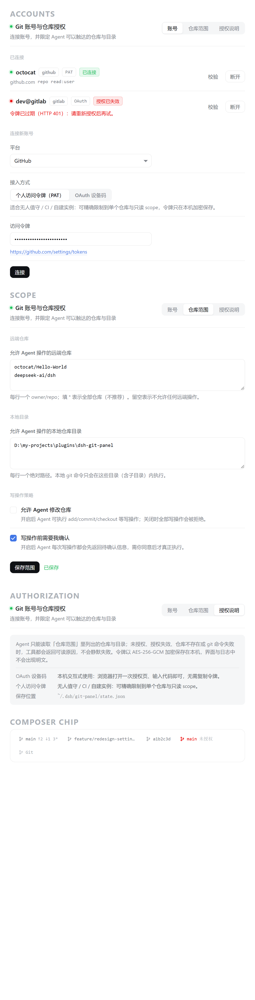
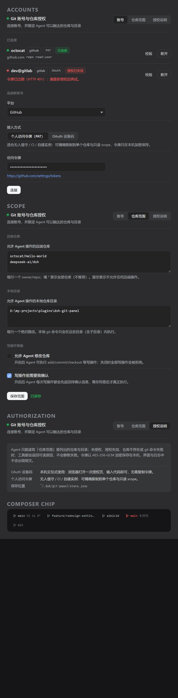
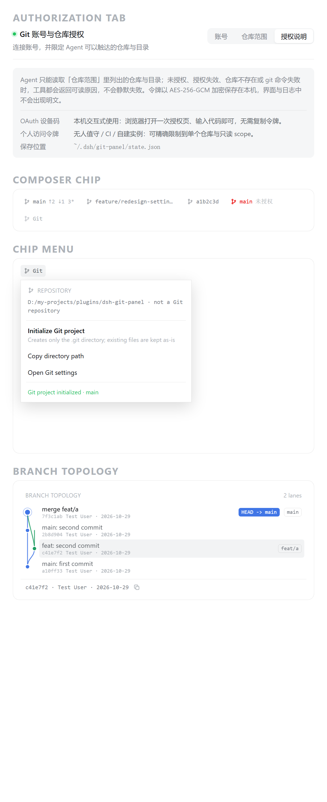
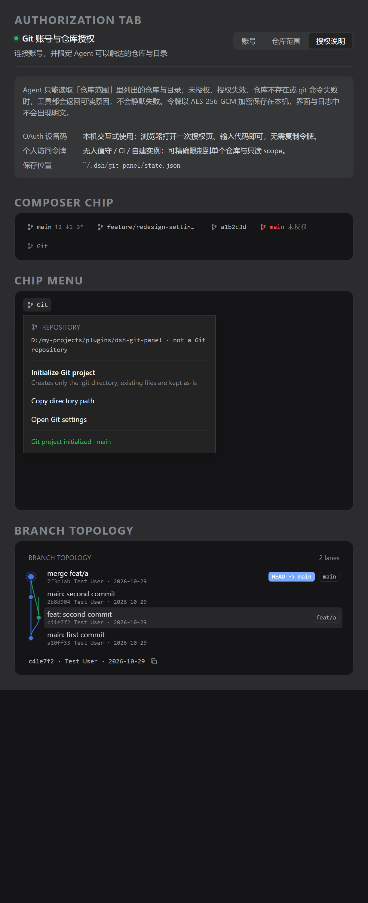

# dsh-git-panel

DSH（DeepSeek Harness）桌面端插件：**Git 账号接入 + 受控仓库操作**。

配置全部放在 **DSH 设置页**（左侧导航新增 `Git` 分节）；输入框下方左侧只保留一个 **opencode 风格的分支状态 chip**（如 `⎇ main ↑2 3*`），点它直接跳到设置页。同时把 Git 查询与受控写操作封装成 Agent 可直接调用的工具。

---

## 一、能力总览

| 模块 | 说明 |
| --- | --- |
| 配置位置 | **DSH 设置页** → 左侧导航 `Git` 分节（`settings.section` slot，`order: 20`） |
| 输入区显示 | **opencode 风格分支 chip**：`⎇ <分支名>` + `↑N`/`↓N`/`N*`（ahead/behind/改动数）；游离 HEAD 显示短 SHA；**非 Git 仓库时保留一个灰化的 `Git` 入口**（悬停提示「当前会话目录不是 Git 仓库」），只有取不到会话目录时才整块不渲染 |
| 点击 chip | **先检测再决定**：弹出插件自绘菜单（不依赖宿主快捷键），菜单随检测结论变化 —— 未初始化时首项是「初始化 Git 项目」（提示只创建 `.git`、不删不改现有文件）；已初始化时只给「刷新状态」，不再出现初始化入口；检测失败时显示失败原因 + 「重新检测」，不给初始化按钮 |
| 分支拓扑 | 菜单里渲染**车道式提交图**（`/repo/graph`）：每条活跃分支固定车道、8 色循环按车道取色、节点/同车道竖线/跨车道 S 形贝塞尔三种图元，分叉与汇合位置准确；悬停或点选某行高亮并在底部显示 `short · author · date` 与复制按钮；默认最近 30 条（5–100 可调），超出时标注「仅显示最近 N 条」 |
| 状态跟随项目 | chip 的 cwd 通过 `useSyncExternalStore` 订阅会话列表快照；**切换/加载项目会先清空上一次结果再重新检测**，菜单每次打开也会重新检测一次 |
| 账号接入 | OAuth 设备码 / 个人访问令牌（PAT）两种方式，支持 GitHub、GitLab、Gitea |
| 授权状态 | 已连接账号列表、平台、接入方式、scopes、`connected` / `expired` / `error` 状态徽章、最近一次校验时间与错误 |
| 断开 / 重新授权 | 每个账号可单独「校验」与「断开」；同平台同登录名再次连接视为重新授权并覆盖旧记录 |
| 仓库范围 | `allowedRepos`（`owner/repo` 白名单，`*` 表示全部）、`allowedRoots`（本机绝对路径白名单，`*` 表示不限制目录） |
| API 地址 | 每个账号记录 `apiBase`（REST API 根地址，如 `https://api.github.com`），与网页域名 `host` 分开存：GitHub 的 API 不在 `github.com` 上，混用会拿到 410 |
| 写操作闸门 | `allowWrite` 默认关闭；开启后仍默认 `requireConfirm`，需二次确认才真正执行 |
| Agent 工具 | 8 个 `git_*` 工具，见第五节 |
| 凭据安全 | AES-256-GCM 落盘，界面与接口一律不回显明文令牌，日志走脱敏规则 |

---

## 二、安装

```bash
# 在插件目录构建
npm install --include=dev
node scripts/build.mjs

# 安装到 desktop profile
"D:/apps/dsh-desktop/resources/runtime/cli/bin/dsh.cmd" plugin --profile desktop add "D:/my-projects/plugins/dsh-git-panel"
```

装完重启桌面端（node 半边与 client 模块表在启动时扫描 `dsh.client` 行）；client 半边改动后需在 GUI 里 **Ctrl+Shift+R 硬刷新**。

卸载：

```bash
"D:/apps/dsh-desktop/resources/runtime/cli/bin/dsh.cmd" plugin --profile desktop remove dsh-git-panel
```

---

## 三、账号授权配置方式

### 方式一：OAuth 设备码（推荐本机交互式使用）

打开 **设置页 → Git → 账号**，选平台 → 接入方式选「OAuth」→ 填该平台的 OAuth App **Client ID** → 「连接」。

- GitHub：`POST https://github.com/login/device/code` → 浏览器打开授权页、输入 8 位代码 → 插件自动轮询换取令牌。
- GitLab：`POST https://gitlab.com/oauth/authorize_device`（自建实例需先在实例上开启 device flow）。
- Gitea：需自填实例地址与 API Base，并确认实例支持 device flow。

安全细节：设备码只存在服务端内存，页面拿到的是一次性 `pollKey`；`pollKey` 20 分钟过期，授权成功后立即失效。

> 适合：本机、有人在场点一次浏览器。不适合：CI / 无人值守。

### 方式二：个人访问令牌 PAT（推荐 CI 与无人值守）

点 **设置页 → Git → 账号**，接入方式选「PAT」→ 粘贴令牌 → 「连接」。

- GitHub：Fine-grained token，可精确限制到单个仓库与只读权限（`Settings → Developer settings → Personal access tokens`）。
- GitLab：`User Settings → Access Tokens`，建议只勾 `read_api` + `read_repository`。
- Gitea：`Settings → Applications → Generate New Token`。

> 适合：CI、脚本、无法打开浏览器、需要最小权限的场景。令牌可随时在平台侧撤销。

### 仓库范围（必须配置，否则 Agent 拒绝一切操作）

**设置页 → Git → 仓库范围**：

- **允许的远程仓库**：每行一个 `owner/repo`；`*` 表示不限。
- **允许的本机目录**：每行一个绝对路径，如 `D:\my-projects\app`。
- **允许写操作**：默认关闭。
- **写操作需要二次确认**：默认开启。

范围为空 = 全部拒绝（fail-closed）。路径比较按路径段进行，`D:\repo-evil` 不会命中 `D:\repo` 的授权。

---

## 四、数据存放

| 内容 | 路径 |
| --- | --- |
| 状态（账号元数据、范围设置） | `$DSH_HOME/git-panel/state.json`（默认 `~/.dsh/git-panel/state.json`） |
| 加密密钥 | `$DSH_HOME/git-panel/key.bin`（0600） |
| 令牌密文 | 存在 `state.json` 的 `secret` 字段，格式 `v1.<base64(iv|tag|ciphertext)>` |

`state.json` 写入走「临时文件 + rename」，权限 0600；文件损坏时自动改名为 `.broken` 并重建，不会因坏文件导致插件启动失败。

界面与 `/state`、工具返回值中的 `secret` 一律置空；日志经 `redact()` 处理，覆盖 `ghp_*` / `github_pat_*` / `glpat-*` / `Authorization: Bearer|Basic|token` / URL 内嵌密码 / `access_token=` 等查询参数。

---

## 五、Agent 可用工具

| 工具 | 作用 | 是否改状态 |
| --- | --- | --- |
| `git_panel_status` | 账号（脱敏）、授权范围、写开关现状 | 否 |
| `git_repo_info` | 当前分支、远端（脱敏）、改动文件数、文件数、最近提交 | 否 |
| `git_branches` | 分支列表（含上游、ahead/behind、是否当前） | 否 |
| `git_diff` | 差异：`worktree` / `staged` / `commit` / `range` | 否 |
| `git_log` | 提交记录，支持 author / grep / since / path 过滤 | 否 |
| `git_remote_info` | 远程仓库元信息（默认分支、可见性、stars、最近推送） | 否 |
| `git_write` | 受控写操作：`add` / `commit` / `checkout` / `switch` / `restore` / `stash` / `tag` | **是** |
| `git_confirm` | 确认或取消上一步 `git_write` 的待执行操作 | **是** |

统一约束：

1. **先授权后操作**：所有涉及目录的工具先查 `allowedRoots`（`*` 视为不限制），再校验目标是否真是 git 仓库；未授权路径连「是不是仓库」都不告知。
2. **改状态前必须说明**：`git_write` 在 `requireConfirm` 开启时只返回 `{pending:true, summary, reason}` 与 18 位 `confirmToken`（5 分钟有效），`summary` 明确写出「将要执行的命令 + 目标仓库绝对路径」；未确认前仓库状态不变。
3. **失败保留 Git 输出**：错误信息包含原始 stderr 关键行，并对常见失败给出人话解释（not a git repository / no commits yet / pathspec did not match / Authentication failed / would be overwritten）。
4. **不走 shell**：`execFile('git', args)`，并拒绝 `--upload-pack=`、`--exec=`、`--receive-pack=`、`--template=`、`--separate-git-dir=`、`--open-files-in-pager=`、`--pager=` 等可注入参数的选项；env 设 `GIT_TERMINAL_PROMPT=0`、`GIT_ASKPASS=''`、`GIT_PAGER=cat`、`GIT_EDITOR=true`。

---

## 六、本地 HTTP 接口（设置面板使用）

前缀 `/dsh-git-panel`：

| 方法 | 路径 | 说明 |
| --- | --- | --- |
| GET | `/health` | 健康检查（status / plugin / version / uptime / accounts） |
| GET | `/state` | 账号（脱敏）+ 设置 + 平台元数据 |
| GET | `/providers` | 平台元数据 |
| GET | `/repo/status?cwd=<绝对路径>` | 供输入区分支 chip 使用：`{isRepo, root, branch, detached, head, ahead, behind, changed, authorized, reason}`；`reason` 三态区分结论 —— `repo`（确认是仓库）/ `no-repo`（目录存在但没有 `.git`，**只有这种才允许显示初始化**）/ `invalid`（路径非法、不存在、不可读 —— 属于检测失败，不能当成未初始化）；非仓库不是错误（`isRepo:false`），未授权目录返回 `authorized:false` 且不泄露 ahead/behind |
| GET | `/repo/graph?cwd=<绝对路径>&limit=<5-100>` | 供 chip 菜单的分支拓扑图使用：`{isRepo, root, branch, head, detached, reason, truncated, laneCount, rows}`；每行 `rows[i]` 含 `{hash, short, parents, author, date, subject, refs, row, lane, segments, through}` —— `lane` 是本行所在车道、`segments` 是向下连到父提交的线（`from === to` 为同车道直落，否则为跨车道转折）、`through` 是穿过本行的其他车道；未授权目录返回 `authorized:false` 且 `rows` 为空、`laneCount:0`（不泄露提交历史） |
| POST | `/repo/init` | 在会话目录执行 `git init -b main`（幂等：已有 `.git` 返回 `created:false`，绝不覆盖，**且不删除/不改动目录里已有文件**）；必须先过同源校验 + `allowedRoots` 授权闸门，未授权目录 403 且不创建任何文件 |
| POST | `/pat/connect` | PAT 接入 |
| POST | `/oauth/start` | 发起设备码流程，返回 `pollKey` 与 `userCode` |
| POST | `/oauth/poll` | 用 `pollKey` 轮询（不传设备码） |
| POST | `/accounts/remove` | 断开账号 |
| POST | `/accounts/recheck` | 重新校验令牌 |
| POST | `/settings` | 保存仓库范围与写开关 |

加固项：请求体上限 256 KiB（超限 413 并断开）；同源校验（跨站 403）；`cache-control: no-store` + `x-content-type-options: nosniff`；未知接口 405/404。

---

## 七、开发与验证

```bash
npm run bundle        # 构建 lib/index.js + lib/client.js
npm run typecheck     # tsc --noEmit
npm run gates         # 60 项插件契约门禁
npm run test:hardening# 112 项加固回归（含真实 git 仓库端到端）
npm run preview       # 用真实 CSS + 宿主 token 渲染 docs/preview/*.png（需要本机 Edge）
npm test              # gates + hardening
```

`test:hardening` 用 mock ctx 驱动**构建产物 `lib/index.js`**，在临时 `DSH_HOME` 下跑，覆盖：路由注册、工具注册、跨站/超大请求拦截、设置归一化、密文不外泄、OAuth 缺 clientId 提示、未授权仓库/目录拒绝、写操作默认拒绝、`/repo/status` 的六种形态（缺 cwd / 非仓库且 `reason=no-repo` / 目录不存在与相对路径 `reason=invalid` / 已授权真实仓库 `reason=repo` / 未授权不泄露 ahead-behind）、`/repo/init` 的十种形态（未授权拒绝且不落 `.git` / 已授权创建 / 回报分支 / 幂等 / 缺 cwd / 目录不存在 / **初始化后原有文件与子目录内容原样保留**）、真实仓库的 status/branches/diff/log 与「确认前不执行、取消不执行、确认后执行、令牌不可复用」。

---

## 八、目录结构

```
src/
  index.ts            node 半边入口（注册路由 + 工具）
  types.ts            本地 ctx 类型（避免静态依赖 @deepseek-ai/*）
  node/
    paths.ts          DSH_HOME / 状态文件 / 密钥文件路径
    vault.ts          AES-256-GCM 加解密 + 脱敏规则
    store.ts          状态读写、范围判定
    providers.ts      GitHub / GitLab / Gitea 的 API 与 OAuth 设备码流程
    git.ts            git 命令执行与失败解释
    tools.ts          8 个 Agent 工具
    handler.ts        HTTP 路由
  client/
    index.tsx         React 组件：GitSection（设置页 settings.section）+ BranchChip（输入区 conversation.input.left）
scripts/
  build.mjs           esbuild 双产物
  gates/run.mjs       契约门禁
  test-hardening.mjs  加固回归
```

---

## 九、已知边界

- client 半边只注册 slot（`settings.section` + `conversation.input.left`），不写 DOM 注入；若宿主未提供某个 slot，对应 UI 不会出现（控制台会记录 `[dsh-git-panel] … 注册失败`）。
- 分支 chip 的 cwd 来自 `sessions.list.getSnapshot().byId[sessionId].cwd`；DSH 的会话快照没有「当前会话」字段，取不到 cwd 时 chip 整块不渲染（不报错、不占位）。取到 cwd 但该目录不是 Git 仓库时，chip 降级为一个灰化的 `Git` 入口（`data-norepo="1"`），点击仍可进设置页——避免「插件看起来没装」的误解。
- 点 chip 弹出的是插件**自绘菜单**（仓库摘要 / 分支拓扑图 / 初始化 Git 项目 / 刷新 / 复制路径 / 打开 Git 设置）。菜单项「打开 Git 设置」按可信度三级降级：① 点宿主设置触发按钮（`button[aria-haspopup="dialog"]` 且文案匹配 `设置|Settings|Preferences`，`aria-expanded="true"` 时跳过，否则会把它关掉）→ ② `shortcuts.registry.invoke('settings.open', …)`（原生菜单走的同一条路，不校验 isTrusted）→ ③ 派发 `Ctrl+,`（仅 Web 端有效）。**不能只派发合成键盘事件**：桌面端 `installNativeKeyboard` 接管后 `installKeyboard` 里 `if (native) return` 直接跳过 DOM keydown 分支，合成事件永远到不了命令。面板打开后还会把左侧导航切到 Git 分节（按导航行文案匹配，检查 `aria-current`）。
  - **触发按钮必须同时满足「文案匹配」+「排除 `[data-team-action]`」**：宿主把设置入口渲染在 `settings.launcher` slot 的 fallback 里，而 `@deepseek-ai/dsh-client-ui-settings-account` 无条件占用了该 slot（账号菜单），所以真正的设置按钮**根本不在 DOM 里**；此时页面上其余 `aria-haspopup="dialog"` 按钮都是别的浮层——`[data-team-action]` 的「智能体团队」触发按钮就是其中之一。早期实现写成「文案不匹配就退化成 `usable[0]`」，于是点「打开 Git 设置」实际打开了智能体团队面板。现在找不到文案匹配的按钮就直接走第 ② 条，**绝不退化成取第一个按钮**。
- **点击 chip 的判定顺序**：先请求 `/repo/status` 再决定菜单内容 —— `reason=no-repo` 才显示「初始化 Git 项目」；`reason=repo` 只显示「刷新状态」（已初始化的项目不会被要求再初始化）；`reason=invalid` 或请求失败显示失败原因 + 「重新检测」，**不给初始化按钮**（避免把路径错误误判成「未初始化」）。切换项目时先清空上一次结果再检测，菜单每次打开也会重新检测一次。
- 「初始化 Git 项目」只在目录已通过 `allowedRoots` 授权时可用；未授权目录会被 403 拒绝且不会创建任何文件（`/repo/init` 先判授权，再执行 `git init`）。`git init` 只创建 `.git` 目录，**不删除、不覆盖、不暂存目录里已有的任何文件**。
- **分支拓扑的取舍**：图里只做「看」，不做 checkout/merge 等写操作 —— 写操作仍走 `git_write` 工具并强制二次确认，避免在浮层里误点改仓库状态；图默认只取最近 30 条，历史很长的仓库需要靠 `limit` 参数（5–100）调整。
- node 半边改动需要重启 DSH 桌面端才生效（`/repo/status`、`/repo/init` 等新路由属于 node 侧）；client 半边改动只需 GUI 硬刷新。
- OAuth 需要用户自备各平台的 OAuth App Client ID（插件不分发 Client Secret，也不做回调服务器）。
- `git_remote_info` 走平台 REST API，受平台限流影响；限流时返回 429 的可读提示。
- 写操作白名单刻意不含 `push` / `reset --hard` / `clean -fdx`，需要时请人工执行。

---

## 十、视觉规范

界面刻意**不做独立皮肤**，而是贴着宿主设置页的度量与主题 token 走，这样深浅主题、字号、圆角、分隔线都与 DSH 其余设置项一致：

| 维度 | 取值来源 |
| --- | --- |
| 内容宽度 | 宿主设置面板 800px，减去导航 188px 与左右内边距 `0 24px` → 实际内容宽 612px；插件不再自设 `max-width` |
| 行式布局 | 参照宿主 `.PgWN5G_row`：`border-bottom: .5px solid var(--dsw-alias-border-l2)` + `padding: 13px 0` + 左主区/右操作区两端对齐 |
| 字号 | 标题 14px/22px、正文与说明 12px/18px、分组小标题 11px/16px 大写、等宽处走 `--ds-font-family-code` |
| 颜色 | 只用 `--dsw-alias-label-primary/secondary/tertiary/caption`、`--dsw-alias-bg-layer-1/2`、`--dsw-alias-bg-module-platform`、`--dsw-alias-border-l2/l3`、`--dsw-alias-state-*`，并各带一份浅色 fallback |
| 圆角/动效 | `--dsw-radius-xs/sm`、`--ds-ease-in-out`、`--ds-transition-duration-fast` |
| 分段控件 | inset 底色 + 选中项浮到 `bg-layer-1` 并加 `--dsw-shadow-lv1`，与宿主 tab 观感一致 |
| 单行控件 | 输入框/下拉定宽 340px，不铺满整行，避免整页变成表单 |
| 输入区分支 chip | 22px 高、等宽字体 11px、无边框、默认 `--dsw-alias-label-tertiary`，hover 才出现底色 —— 与 opencode 的低存在感风格对齐，不抢输入框注意力 |
| 分支拓扑图 | 车道宽 13px、行高 34px、节点半径 4px（HEAD 放大到 5.4px + 半径 8px 描边外环）；SVG 与行文本同一 flex 行，图区 `max-height: min(320px, 46vh)` 且 `overflow:auto`（窄窗口横向滚动而不压缩车道）；带图时菜单宽 `min(440px, calc(100vw - 16px))`、高 `min(520px, 72vh)` |
| chip 弹出菜单 | 236–320px 宽、`--dsw-alias-bg-layer-1` 底 + `.5px` 边框 + `--dsw-elevation-prominent` 阴影、行高 7px/9px 内边距，菜单项左图标 12px、标题 12px + 说明 11px；**用 `createPortal` 挂到 `document.body`**，`position: fixed` + `z-index: 1200`（宿主浮层最高 1100），上方空间不足时自动翻到 chip 下方，水平方向收敛在视口内 |

预览截图（用构建产物里的真实 CSS + 宿主浅/深两套 token 渲染，`docs/preview/`）：

| 浅色 | 深色 |
| --- | --- |
|  |  |
|  |  |

重新生成预览：`node scripts/preview.mjs`（需要本机 Edge；从 `lib/client.js` 抽真实 CSS 渲染 HTML 再无头截图到 `docs/preview/`）。
